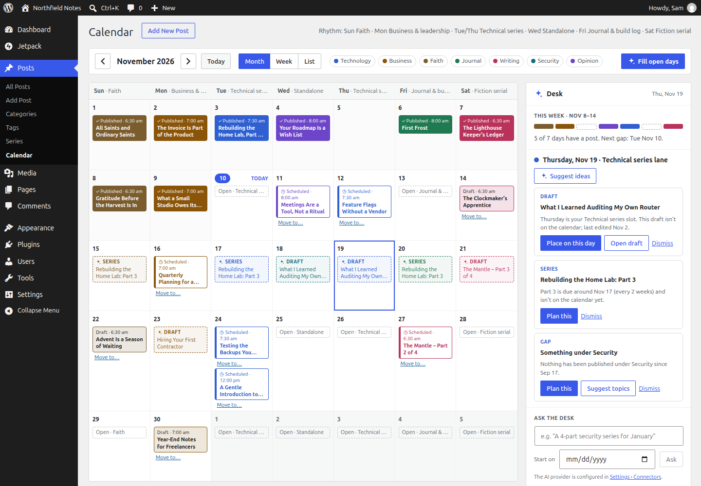
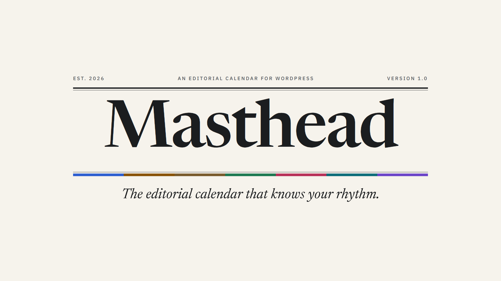
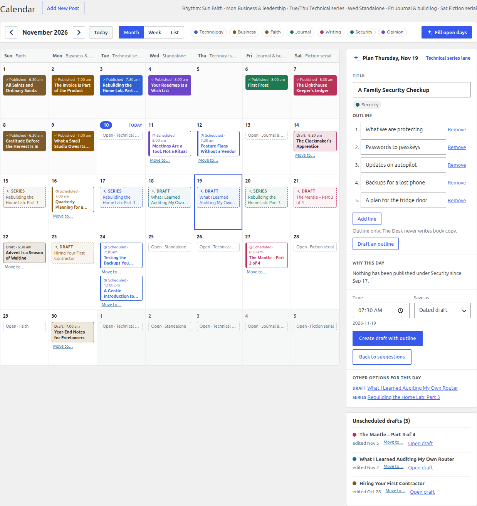
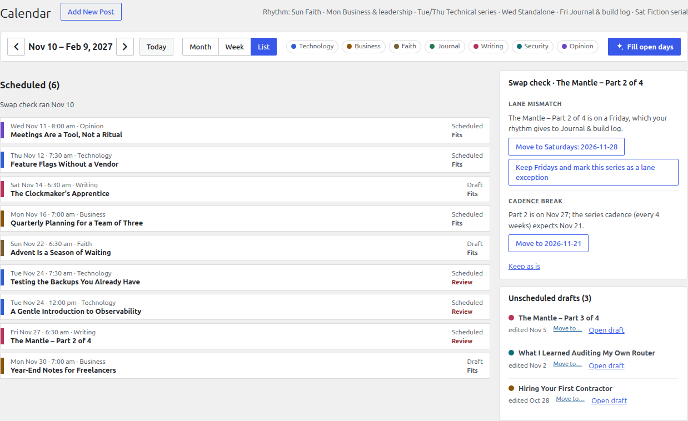
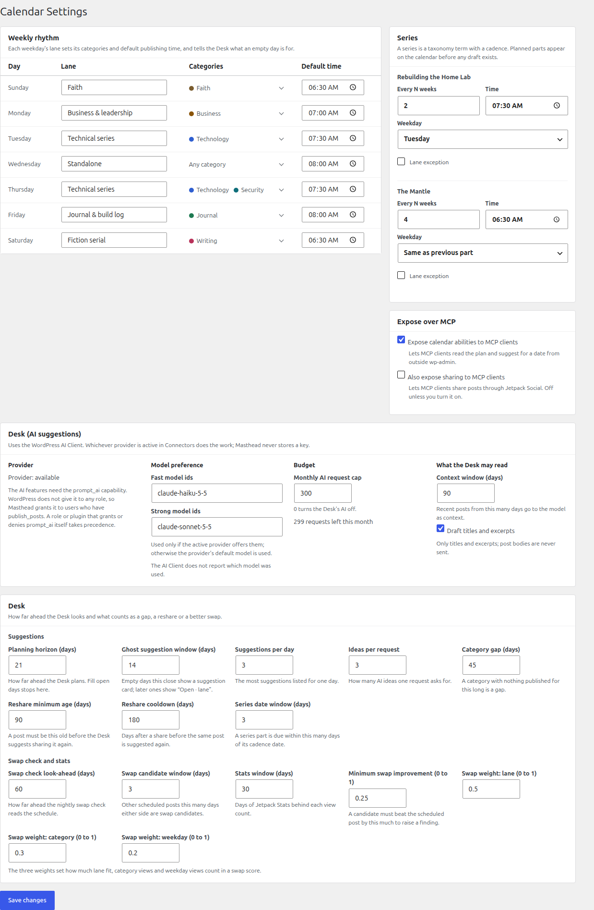

<div align="center">

# Masthead

**The editorial calendar that knows your rhythm.**

Plan a month of posts in WordPress on a weekly rhythm, with a Desk that tells you what belongs on every open day, and why.

[](https://github.com/ericmann/masthead/actions/workflows/ci.yml)
[](https://github.com/ericmann/masthead/releases/latest)
[](LICENSE)
[](https://wordpress.org/)
[](https://www.php.net/)
[](#works-with-your-ai-assistant)
[](#works-with-your-ai-assistant)

[Quick start](#quick-start) · [Features](#what-you-get) · [Honest by design](#honest-by-design) · [MCP](#works-with-your-ai-assistant) · [FAQ](#faq)



</div>

## Why Masthead

Publishing on a schedule is easy to promise and hard to keep. The posts that slip are rarely the hard ones: they are the Tuesday you forgot was empty, the series part that drifted a week, the good post from last spring nobody has seen since.

Masthead puts your whole publishing plan on one screen in wp-admin and gives every weekday a job. Mondays are for business, Saturdays for fiction, whatever your rhythm is. Then it looks at the gaps and tells you, in plain language, what could fill them: a draft you already wrote, the next part of a series, a post worth sharing again, a category you have neglected, or (if you want it) a fresh AI idea with an outline.

You stay the editor. Masthead never publishes, moves or shares anything without your click.

## What you get

**📅 A calendar of everything you publish.** Month, week and list views of published, scheduled and planned posts, coloured by category. Drag a post, or use the keyboard, to move it to another day; Masthead keeps its status exactly as it was.

**🎼 A weekly rhythm.** Give each weekday a lane, with its categories and a default publishing time. Every day on the calendar shows its lane, and every empty slot shows what it is for.

**🗞️ The Desk.** Pick a day and the Desk suggests what could go there, in a fixed order: your own unscheduled drafts first, then the next part of a series, then posts worth re-sharing, then quiet categories, then AI ideas. Each one says why it is there, and apart from AI ideas, which carry the AI's suggested angle, that reason is built from your real data ("Nothing has been published under Security since Sept 17").

**📝 Day plans that become real drafts.** Turn a suggestion into a dated draft in one step, optionally with an AI outline to start from. Plans are ordinary WordPress drafts, so the block editor, other plugins and your AI assistant all see them.

**🔁 Series that keep their cadence.** Masthead knows each series' rhythm (every four weeks on a Saturday, say) and puts the next part where it belongs. Ask the Desk for "a 4-part security series starting in January" and it proposes titles while Masthead picks the dates.

**🔍 A nightly swap check.** Every night Masthead reviews the upcoming schedule and flags lane mismatches, two posts on one day, series parts that break their cadence and better-fitting candidates. Each finding explains itself and offers a fix you can apply with one click, or dismiss.

**📣 Re-shares through Jetpack Social.** Bring an evergreen post back to your social accounts now or on a chosen date, with share copy the Desk can draft for you.

**🤖 AI that knows its place.** Ideas, outlines, share copy and series proposals come from whichever provider you configure in WordPress (Anthropic, OpenAI, Google and others via Settings › Connectors). A monthly request cap keeps costs predictable; set it to 0 and the AI is off.

## See it in action

[](https://github.com/ericmann/masthead/releases/latest)

<p align="center"><b>▶ Watch the three-minute demo</b> (the video is attached to the latest release). It runs on a demo site with sample data.</p>

| Turn a suggestion into a dated draft | Fix a schedule the swap check flagged |
|---|---|
|  |  |

<details>
<summary><b>Settings › Calendar</b>: the weekly rhythm, series cadence, MCP exposure, AI budget and the Desk's thresholds</summary>



</details>

## Honest by design

Masthead is built on a few rules it does not bend. Most of them are enforced by automated checks on every commit.

- **No surprise writes.** Nothing is published, rescheduled or shared without a click or an explicit ability call. The nightly job only reads.
- **No invented numbers.** Traffic figures come from Jetpack Stats and nowhere else. When Stats isn't connected, Masthead says "Unavailable" and ranks suggestions without traffic.
- **No made-up reasons.** The "why" behind every draft, series, re-share and gap suggestion, and every swap-check finding, is built from your own posts, dates and stats. The AI writes idea titles, angles, outlines and share copy, never claims about your traffic or history.
- **AI output is checked before use.** Every response is validated against a schema, and ideas outside the day's categories are dropped, not bent to fit.
- **Nothing on your public site.** No front-end output, no tracking scripts, no extra REST data for your theme. Admin assets load only on Masthead's two screens.
- **No keys, no phoning home.** Masthead stores no API keys and makes no network requests of its own; it talks only through Jetpack and the WordPress AI Client.
- **Your plan is plain WordPress.** Planned posts are dated drafts and settings are ordinary options and term meta. Uninstall Masthead and your drafts are still there.

## Works with your AI assistant

Every action in Masthead is a [WordPress Ability](https://developer.wordpress.org/apis/abilities/) under `masthead/*`. The calendar screens, WP-CLI and AI assistants all call the same code with the same permission checks.

Install the [MCP Adapter](https://github.com/WordPress/mcp-adapter), turn on **Expose calendar abilities to MCP clients** under Settings › Calendar, and an MCP client such as Claude can work with your plan directly:

> *"What's on my calendar for the next two weeks, and where are the gaps?"*
>
> *"Which drafts would fit next Wednesday's lane?"*
>
> *"Create a dated draft for Friday called 'Build log: shipping the new front page', with an outline."*
>
> *"Did last night's swap check flag anything?"*

Sharing to social accounts has its own switch and stays off for MCP clients unless you turn it on.

## Quick start

1. Download `masthead.zip` from the [latest release](https://github.com/ericmann/masthead/releases/latest), and check it against the published checksum:
   ```sh
   sha256sum -c masthead.zip.sha256
   ```
2. In wp-admin, go to **Plugins › Add New › Upload Plugin**, upload the zip and activate it.
3. Open **Settings › Calendar** and set your weekly rhythm: a lane, its categories and a default time for each weekday.
4. Open **Posts › Calendar** and click any day.

Optional extras:

- **[Jetpack](https://jetpack.com/)** with Stats and Social connected adds traffic numbers, re-share suggestions and sharing.
- **An AI provider** under **Settings › Connectors** (for example [AI Provider for Anthropic](https://wordpress.org/plugins/ai-provider-for-anthropic/)) adds ideas, outlines, share copy and series proposals. Users who can publish posts get access by default.

### Requirements

| | |
|---|---|
| WordPress | 7.1 or later |
| PHP | 8.3 or later |
| Jetpack | Optional, for Stats and Social |
| AI provider | Optional, any provider supported by the WordPress AI Client |

## FAQ

<details>
<summary><b>Does Masthead work without Jetpack or AI?</b></summary>

Yes. The calendar, rhythm, Desk, series and swap check all work on a plain WordPress site. Jetpack adds traffic numbers and sharing, and an AI provider adds ideas and outlines. Without them, those parts of the screen say they are unavailable and explain why.
</details>

<details>
<summary><b>Will it ever publish or move a post on its own?</b></summary>

No. Every change is a click, or an ability call you or your assistant made on purpose. The nightly swap check is read-only: it records findings for you to review.
</details>

<details>
<summary><b>Which AI providers can it use, and what does it cost?</b></summary>

Any provider configured through the WordPress AI Client under Settings › Connectors. You can name preferred fast and strong models, and Masthead uses them if your provider offers them. A monthly request cap (300 by default) limits spending; 0 turns the AI off. AI only runs when someone asks for it.
</details>

<details>
<summary><b>Who on my site can use the AI features?</b></summary>

Anyone who can publish posts, unless a role or plugin explicitly grants or denies WordPress's `prompt_ai` capability, in which case that decision wins.
</details>

<details>
<summary><b>How does it handle series?</b></summary>

If your site already has a `series` taxonomy, Masthead uses it; otherwise it adds its own. Each series can have a cadence (every N weeks, on a weekday, at a time) and can be marked as an exception to the weekly lanes.
</details>

<details>
<summary><b>Is it built for big editorial teams?</b></summary>

Masthead is designed for an individual writer or a small team publishing on a steady rhythm. It has no assignments, approval chains or custom editorial statuses; it works with WordPress's own.
</details>

<details>
<summary><b>Does it slow down my site?</b></summary>

No. Masthead adds nothing to public pages and loads its scripts only on its own admin screens. Its queries are bounded, and the nightly check runs on WP-Cron.
</details>

<details>
<summary><b>Is it on WordPress.org?</b></summary>

Not yet. Releases are published here on GitHub as a zip with a SHA-256 checksum.
</details>

## Reference

<details>
<summary><b>Abilities</b></summary>

Registered in the `masthead` category and run through `/wp-abilities/v1/abilities/<name>/run` (`GET` for read-only abilities, `POST` for the rest).

| Ability | What it does | Capability |
|---|---|---|
| `masthead/get-plan` | Days in a range with their lane, posts and open slots | `edit_posts` |
| `masthead/suggest-for-date` | Desk suggestions for a date, optionally with AI ideas | `edit_posts` (+ `prompt_ai` for ideas) |
| `masthead/dismiss-suggestion` | Hides a suggestion for the current user | `edit_posts` |
| `masthead/create-planned-draft` | Creates a dated draft, optionally with an outline | `edit_posts` |
| `masthead/reschedule` | Moves a scheduled post or dated draft | `edit_post` on that post |
| `masthead/swap-check` | Returns the latest swap-check findings | `edit_posts` |
| `masthead/stats-summary` | Jetpack Stats summary, or why it is unavailable | `edit_posts` |
| `masthead/share-connections` | Lists Jetpack Social connections | `publish_posts` |
| `masthead/share-post` | Shares a published post now or at a date | `publish_posts` |
| `masthead/draft-outline` | AI outline for a post title | `edit_posts` + `prompt_ai` |
| `masthead/draft-share-copy` | AI share message for a published post | `edit_posts` + `prompt_ai` |
| `masthead/propose-series` | AI series proposal with dates chosen by Masthead | `edit_posts` + `prompt_ai` |
| `masthead/accept-series` | Creates a proposed series and its dated drafts | `edit_posts` |
</details>

<details>
<summary><b>WP-CLI</b></summary>

| Command | What it does |
|---|---|
| `wp masthead plan <from> <to>` | Prints the plan for a date range |
| `wp masthead suggest <date> [--ideas]` | Prints the Desk suggestions for a date |
| `wp masthead swap-check [--write]` | Runs the swap check; `--write` stores the findings |
| `wp masthead ai:status` | Shows whether an AI provider is available, the budget left and the model lists |
| `wp masthead stats:probe` | Prints scrubbed Jetpack Stats payload shapes |
| `wp masthead social:probe` | Prints scrubbed Jetpack Social payload shapes |
| `wp masthead seed --fixture=<file> [--now=<datetime>] [--reset]` | Loads the acceptance fixture (development) |
</details>

<details>
<summary><b>Development</b></summary>

You need PHP 8.3+, Composer, Node.js 24 and Docker (for wp-env). Run `composer install` and `npm install` once.

| Purpose | Command |
|---|---|
| PHP lint | `composer lint` |
| PHP unit tests | `composer test:unit` |
| JS and CSS lint | `npm run lint` |
| JS unit tests | `npm run test:unit` |
| Build | `npm run build` |
| Structural checks | `bash scripts/forbidden-patterns.sh` |
| Integration tests | `npm run test:integration` (wp-env) |
| End-to-end tests | `npm run test:e2e` (wp-env and Playwright) |
| README screenshots | `npm run screenshots` |
| Release zip | `npm run release:pack` |

[`docs/SPEC.md`](docs/SPEC.md) is the specification and [`CLAUDE.md`](CLAUDE.md) lists the rules the code follows. Releases are built by the release workflow from a `v*` tag.
</details>

## License

Masthead is free software, licensed under the [GPL-2.0-or-later](LICENSE).
